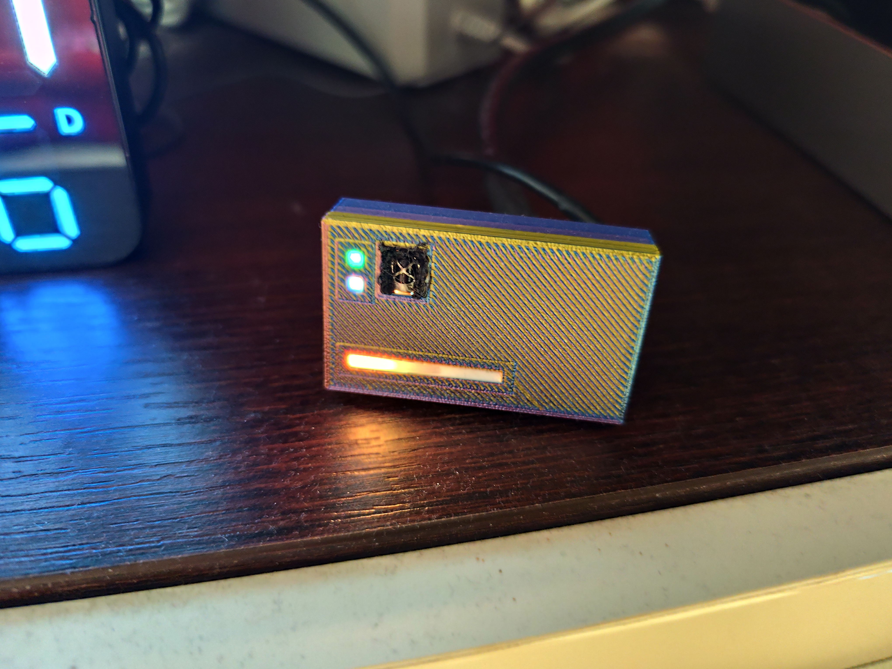
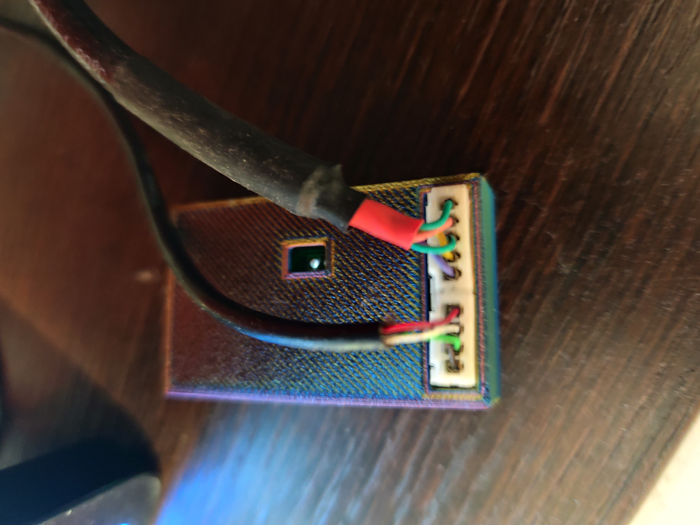
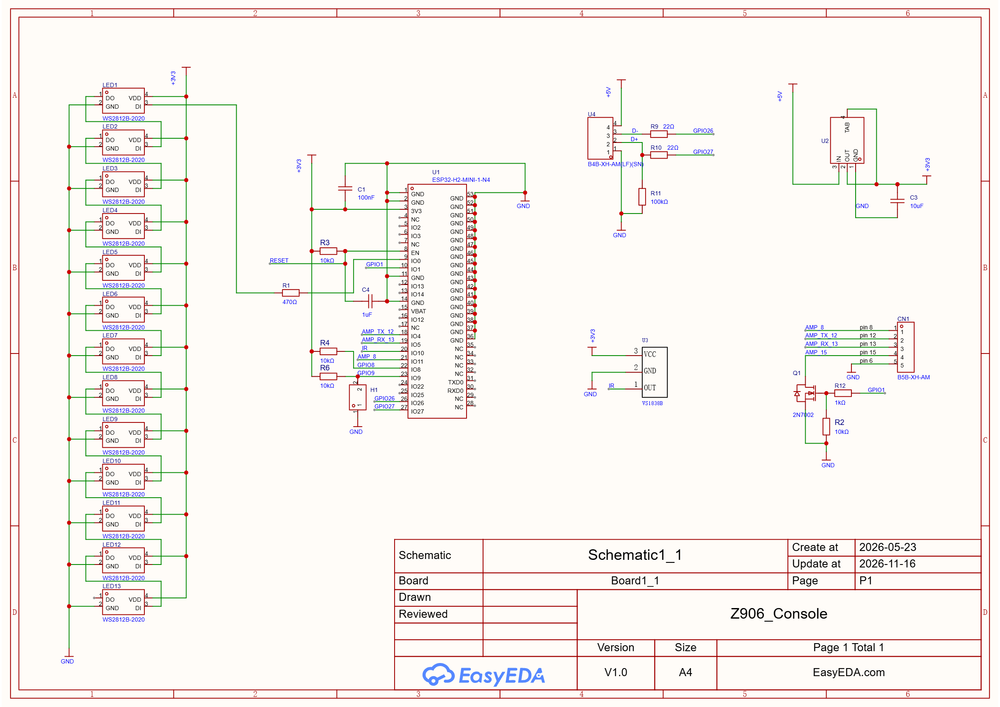
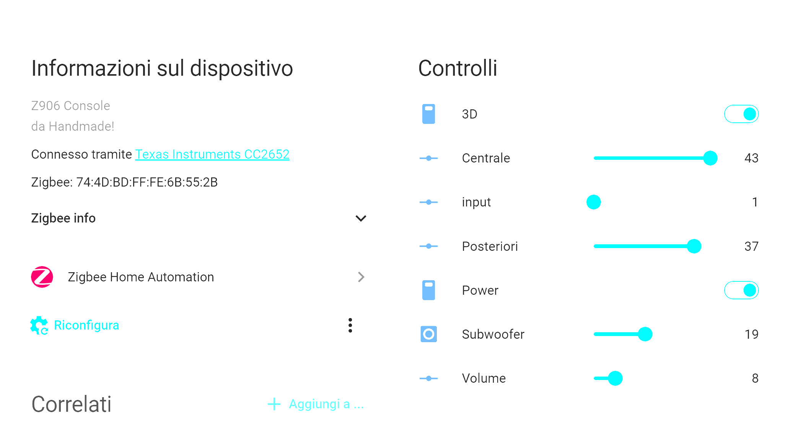

# Logitech Z906 — Zigbee replacement console (ESP32-H2)

A replacement for the original Logitech Z906 control console, built on an **ESP32-H2**.
It talks to the Z906 amplifier over the console DB-15 serial line and exposes the whole
system to **Home Assistant (ZHA)** over Zigbee. It also keeps the original IR remote
working (volume and mute) and shows status, input and volume on a WS2812B LED bar.

| Front | Rear | Inside |
|---|---|---|
|  |  |  |
| Status and input LEDs, IR window, volume bar | 5-pin amplifier connector and 4-pin USB connector | PCB in the 3D-printed enclosure (ESP32-H2-MINI-1, VS1838B, WS2812B-2020) |

## Features

- **Power on/off** of the amplifier, with the real state reported to Home Assistant
  (also after a power loss of the console).
- **Main volume** (0–43), **input** (1–6), **rear / centre / subwoofer levels** (0–43).
- **3D effect** switch for input 3 (optical), stored in flash.
- **IR remote** (original Z906 remote, NEC): Vol+, Vol− (single press and hold) and Mute.
  Frames from other remotes (e.g. a TV remote) are ignored.
- **LED bar**: 13 × WS2812B-2020 — console status, selected input, 11-LED volume bar.
- **State restored after power loss**: input, levels and 3D setting are saved in NVS and
  re-applied when the amplifier is switched on (the amplifier itself only saves its settings
  on a regular power-off command).
- Logs on **USB Serial/JTAG** only — the UART is reserved for the amplifier.

## Repository layout

| Path | Content |
|---|---|
| `firmware/` | ESP-IDF project (ESP32-H2) |
| `firmware/main/` | `main.c` (amplifier protocol, IR, LEDs, Zigbee), `ota.c/.h` (version, rollback) |
| `binaries/` | Ready-to-flash firmware v3 (see [Flashing without ESP-IDF](#flashing-without-esp-idf)) |
| `hardware/` | EasyEDA Pro schematic and PCB (`.epro2`), schematic image, photos |
| `hardware/Enclosure/` | 3D-printable enclosure: `z906.stl` (ready to slice) and `Z906.skp` (original SketchUp model) |

## Hardware



### Connectors and cables

**Power / USB — U4, JST XH 4-pin (B4B-XH-AM)**

| U4 pin | Signal |
|---|---|
| 4 | +5 V |
| 3 | USB D− (22 Ω → GPIO26) |
| 2 | USB D+ (22 Ω → GPIO27) |
| 1 | GND |

A USB cable ending in a JST XH 4-pin plug. **External 5 V power is required**: the console is
powered through this USB connector (5 V → 3.3 V LDO), not by the amplifier. The same connection
is used for logs and flashing.

**Amplifier — CN1, JST XH 5-pin (B5B-XH-AM)**

Cable: on one side a **DB-15 high-density plug (3 rows, VGA type)** going into the console port
of the subwoofer (central unit), on the other side a JST XH 5-pin plug into CN1.

| CN1 pin | DB-15 pin | Signal | ESP32-H2 |
|---|---|---|---|
| 1 | 8 | Amplifier status | GPIO11 (direct) |
| 2 | 12 | Amplifier TX → console | GPIO4 (UART RX) |
| 3 | 13 | Console → amplifier RX | GPIO5 (UART TX) |
| 4 | 15 | Power control | Q1 2N7002 drain (gate: GPIO1 via 1 kΩ, 10 kΩ pull-down) |
| 5 | 6 | GND | GND |

### Bill of materials

| Ref | Part | Qty |
|---|---|---|
| U1 | ESP32-H2-MINI-1-N4 | 1 |
| U2 | 3.3 V LDO regulator, SOT-223 | 1 |
| U3 | VS1838B IR receiver | 1 |
| Q1 | 2N7002 N-MOSFET (SOT-23) | 1 |
| LED1–LED13 | WS2812B-2020 | 13 |
| CN1 | JST XH 5-pin, B5B-XH-AM | 1 |
| U4 | JST XH 4-pin, B4B-XH-AM | 1 |
| H1 | 2-pin header (GPIO9 to GND: boot / factory reset) | 1 |
| R1 | 470 Ω (LED data) | 1 |
| R2, R3, R4, R6 | 10 kΩ (Q1 gate pull-down, EN, GPIO8, GPIO9 pull-ups) | 4 |
| R9, R10 | 22 Ω (USB D−/D+) | 2 |
| R11 | 100 kΩ | 1 |
| R12 | 1 kΩ (Q1 gate) | 1 |
| C1 | 100 nF | 1 |
| C3 | 10 µF | 1 |
| C4 | 1 µF | 1 |

Values and references are from `hardware/Schematic.png`; the LDO part number is not specified there.

### GPIO map


| GPIO | Function |
|---|---|
| GPIO0 | WS2812B data (LED1–LED13 chain) |
| GPIO1 | MOSFET Q1 → amplifier pin 15 (power control) |
| GPIO4 | UART RX ← amplifier pin 12 |
| GPIO5 | UART TX → amplifier pin 13 |
| GPIO9 | Factory reset button (hold 5 s) / boot strap |
| GPIO10 | IR receiver VS1838B (NEC) |
| GPIO11 | Amplifier pin 8 (status input) |
| GPIO26/27 | USB D−/D+ (logs, flashing) |


## LED colours

**LED1 — console status**

| Colour | Meaning |
|---|---|
| Red, slow blink (0.5 s on / 0.5 s off) | Not connected to the Zigbee network (joining / searching) |
| Blue, steady (dim) | Connected to Zigbee, amplifier in standby |
| Green, fast blink | Amplifier power-on in progress |
| Green, steady | Amplifier on |

**LED2 — selected input** (off when the amplifier is in standby)

| Input | 1 | 2 | 3 | 4 | 5 | 6 (AUX) |
|---|---|---|---|---|---|---|
| Colour | White | Cyan | Green | Blue | Magenta | Yellow |

**LED3–LED13 — volume bar** (amber): 11 LEDs with 4 brightness steps each, i.e. 44 steps for
volume 0–43. A LED is fully lit when the volume reaches its last step, partially lit in between.
The bar is off when the amplifier is in standby (and at volume 0, e.g. when muted).

## Zigbee endpoints (ZHA)

Manufacturer `Handmade!`, model `Z906 Console`, router, channel 25.



| EP | Cluster | Entity | Notes |
|---|---|---|---|
| 1 | On/Off | Power | Real amplifier state, reported after every reboot |
| 2 | Analog Output | Volume | 0–43 |
| 3 | Analog Output | Input | 1–6 |
| 4 | Analog Output | Rear level | 0–43 |
| 5 | Analog Output | Centre level | 0–43 |
| 6 | Analog Output | Subwoofer level | 0–43 |
| 7 | On/Off | 3D effect | Input 3 only, saved in NVS |

The firmware version is in the Basic cluster, attribute `sw_build_id` (0x4000).

## Amplifier protocol — what matters

Serial 57600 baud, 8 data bits, **odd parity**, 1 stop bit. The protocol reference is
[nomis/logitech-z906](https://github.com/nomis/logitech-z906/blob/main/protocol.rst);
command codes were cross-checked with [zarpli/Logitech-Z906](https://github.com/zarpli/Logitech-Z906).

- Single-byte commands are echoed; long messages are `AA <type> <len> <data> <checksum>`
  (sum from type to checksum = 0). Received messages are checksum-verified.
- **One request at a time**: the amplifier cannot handle new requests while it is sending a
  long reply (nomis, "Message formats"). All writes go through one serialized function that
  waits for the end of long replies.
- Volume and levels are changed with single-step commands (`08/09` volume, `0A/0B` sub,
  `0C/0D` centre, `0E/0F` rear). **Verified on the amplifier: steps above 43 are ignored.**
- Full status write uses the same format as the status read (`AA 0A 14` + 20 bytes);
  out-of-range values are replaced before writing.
- Mute works like the original console: volume to 0 with `09`, restore with `38`, `08`…, `39`.
- Effects: `14` = 3D, `35` = disabled. Verified: 3D also applies with a 2.1 signal
  (decode state `1B`), not only with 2.0.

## Building

- **ESP-IDF v5.5.6**, target `esp32h2`.
- **esp-zigbee-lib 2.0.5** (no ZBOSS) through its 1.x compatibility layer
  (`CONFIG_ZB_SDK_1xx=y`), plus `espressif/led_strip` 2.5.x. Components are downloaded by the
  IDF Component Manager.

From an ESP-IDF terminal, in `firmware/`:

```
idf.py set-target esp32h2
idf.py -p COMx build flash monitor
```

`sdkconfig` is generated from `sdkconfig.defaults`. Updates are done over USB: Zigbee OTA is not
available in the esp-zigbee-lib 2.0.5 compatibility layer.

## Flashing without ESP-IDF

The `binaries/` folder contains firmware **v3** (ESP-IDF 5.5.6, esp-zigbee-lib 2.0.5), flashed
through the console's own USB connector (ESP32-H2 native USB, no USB-serial adapter needed).
Checksums are in `binaries/SHA256SUMS.txt`.

| File | Offset | Use |
|---|---|---|
| `z906-console-v3-full.bin` | `0x0` | **First installation**: bootloader + partition table + app in one file |
| `bootloader.bin` | `0x0` | Separate parts (same content as the full image) |
| `partition-table.bin` | `0x8000` | |
| `ota_data_initial.bin` | `0x10000` | |
| `z906_console.bin` | `0x20000` | **Update** of an already installed console (application only) |

> **Note:** the full image also overwrites the `nvs` area, so saved settings and the Zigbee
> pairing are erased: the console must be paired again in ZHA. To update a console that is
> already working, flash only `z906_console.bin` at `0x20000`.

**Option 1 — browser (Chrome or Edge, no installation)**

1. Open [ESP Tool (esptool-js)](https://espressif.github.io/esptool-js/) and click **Connect**,
   choosing the console's USB port.
2. Add the file and its offset from the table above (`z906-console-v3-full.bin` at `0x0`
   for a first installation).
3. Click **Program**, then reset or power-cycle the console.

**Option 2 — esptool (Python)**

```
pip install esptool
esptool.py --chip esp32h2 --port COMx write_flash 0x0 z906-console-v3-full.bin
```

Update only:

```
esptool.py --chip esp32h2 --port COMx write_flash 0x20000 z906_console.bin
```

If the board does not enter download mode automatically, keep GPIO9 low (factory reset
button / H1) while powering it up.

## Pairing with Home Assistant (ZHA)

1. In ZHA choose **Add device** (permit join).
2. Power the console: when it is not in a network it searches automatically (LED1 red, slow
   blink); once joined LED1 turns blue.
3. The rear, centre and subwoofer levels appear as generic number entities: rename them in HA.

Factory reset (leave the Zigbee network): hold the button on GPIO9 for 5 seconds.

## Lessons learned

- **Never share the amplifier UART with the console UART.** On ESP32-H2, ROM/ISR prints
  (`esp_rom_printf`, `ESP_DRAM_LOGx`) go to UART0 even when the console is on USB Serial/JTAG
  (ESP32-H2-MINI-1 datasheet, ROM messages printing). With the amplifier on UART0, driver error
  messages were sent to the amplifier as garbage and the audio dropped. The amplifier is on
  **UART1** (same GPIO4/5 through the GPIO matrix).
- **IR receiver buffer**: other remotes send frames longer than 64 RMT symbols; the user buffer is
  512 symbols so they are received whole and discarded silently.
- **ZBOSS (esp-zigbee-lib 1.6.x)**: the neighbour table reported LQI = 255 towards every
  neighbour, attracting routes through this device. Moving to esp-zigbee-lib 2.0.5 (no ZBOSS);
  Zigbee credentials are migrated on first boot with `esp_zigbee_nvram_migrate()`, so the device
  stays paired.
- **Corrupted status**: before checksum verification and serialized writes, a corrupted status
  was written back to the amplifier (rear level 170, invalid effect values).

## Version history

- **v3** — esp-zigbee-lib 2.0.5 (no ZBOSS), ESP-IDF 5.5.6, serialized amplifier writes with
  checksum check, rear/centre/subwoofer levels, 3D switch, state saved in NVS.
- **v2.0** — first version for this PCB (console replacement, IR, LED bar).

## Credits

- [nomis/logitech-z906](https://github.com/nomis/logitech-z906) — protocol documentation.
- [zarpli/Logitech-Z906](https://github.com/zarpli/Logitech-Z906) — Arduino library, command codes.

## License

MIT — see [LICENSE](LICENSE).
